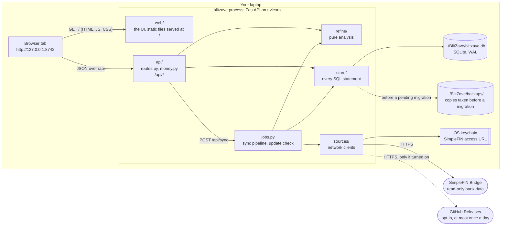
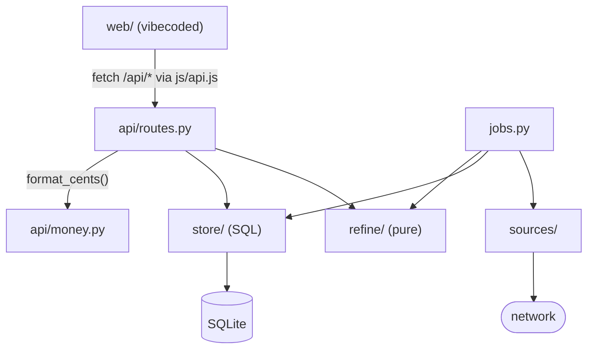
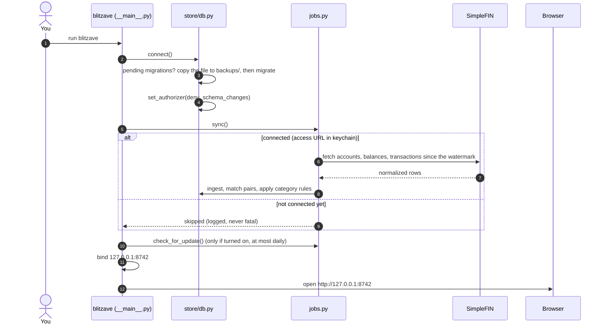
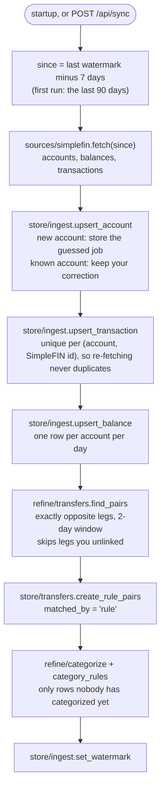
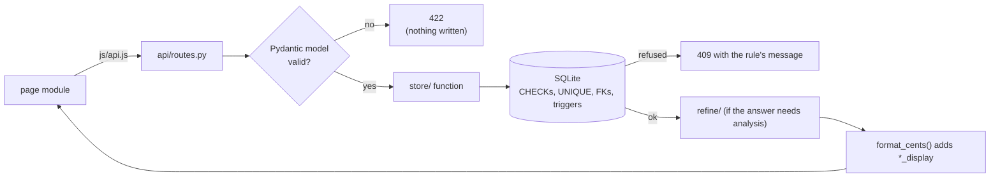
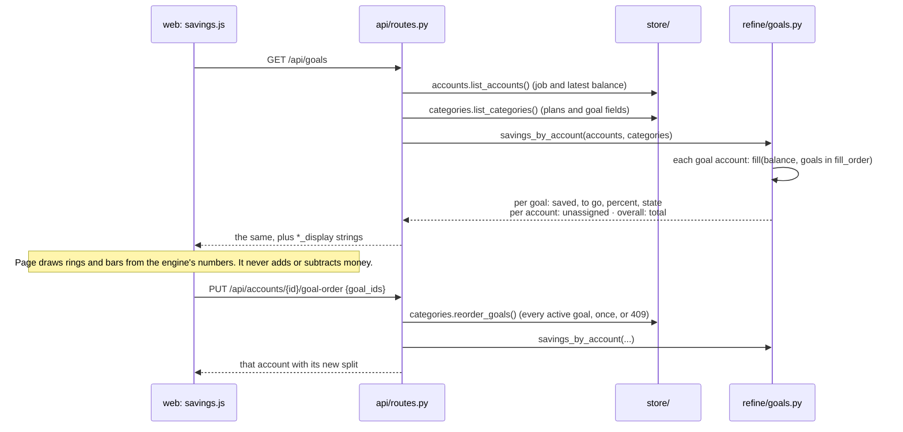

# How BlitZave is built

BlitZave is one Python process on your laptop. It keeps one SQLite file and serves one
web page. This document maps the pieces and follows the data through them. The tables
themselves are in [SCHEMA.md](SCHEMA.md).

Current as of 2026-11-08, schema version 10.

- [The whole system](#the-whole-system)
- [Layers and their rules](#layers-and-their-rules)
- [Module map](#module-map)
- [Starting up](#starting-up)
- [The sync pipeline](#the-sync-pipeline)
- [A request, end to end](#a-request-end-to-end)
- [Goals: from a balance to the Savings page](#goals-from-a-balance-to-the-savings-page)
- [The UI](#the-ui)
- [API endpoints](#api-endpoints)
- [Safety rails](#safety-rails)
- [Files on disk](#files-on-disk)

## The whole system

Everything inside the laptop box works with Wi-Fi off. Only two calls leave the machine:

- the sync with SimpleFIN;
- the update check, which is off until you turn it on.

The UI and the API share one origin, so there's no CORS and no second server.

## Layers and their rules

| Layer | May | May not |
|---|---|---|
| `sources/` | call the network (SimpleFIN; GitHub for the opt-in update check) | touch SQLite. It returns normalized rows (`sources/base.py`) |
| `store/` | read and write SQLite | call the network, or hold business logic |
| `refine/` | compute: facts in, facts out | do any I/O |
| `api/` | validate requests (Pydantic), call `store/` and `refine/`, format money for display | contain SQL, or call `sources/` directly |
| `jobs.py` | orchestrate a sync: `sources/` → `store/` → `refine/` → `store/` | — |
| `web/` | show what the API returns | compute or format money, or call anything but `/api/*` |

The engine (everything but `web/`) is built in small reviewed steps. The UI is
generated quickly, which is safe because the API is a wall: the UI can only show what
the engine already decided.

## Module map

### Engine (`src/blitzave/`)

| File | Job |
|---|---|
| `__main__.py` | The `blitzave` command. Builds the FastAPI app, mounts `web/` at `/` (and `dev/` at `/dev` when it exists), runs the startup sync, binds `127.0.0.1:8742` and opens the browser. |
| `jobs.py` | The sync pipeline (`sync`, `sync_month`), category-rule application, pair matching, and the opt-in daily update check. |
| `backup.py` | Copies the database before a migration and keeps the last three copies. |
| `api/routes.py` | Every `/api/*` endpoint and its Pydantic request models. Maps store errors to 404, 409 and 422. |
| `api/money.py` | `parse_amount()` (text → integer cents) and `format_cents()` (cents → "$1,200.00"). The only money conversions. |
| `sources/base.py` | Normalized row types: `AccountRow`, `TxRow`, `BalanceRow`, `Fetched`. |
| `sources/simplefin.py` | Claims a setup token, keeps the access URL in the keychain, and fetches accounts, balances and transactions. Guesses each account's type from its name. |
| `sources/github.py` | One bare GET for the latest release, when the update check is on. |
| `store/db.py` | Connects to the database (WAL, foreign keys on), runs pending migrations, and then denies schema changes for the rest of the connection. |
| `store/ingest.py` | Upserts accounts, transactions and balances from a sync, and keeps sync watermarks. |
| `store/accounts.py` | Lists accounts with their job and latest balance; corrects an account's type or job. |
| `store/categories.py` | Categories, their plans (amount and schedule), goals (level, home, place in line), goal reordering, and "apply to all" rules. |
| `store/transactions.py` | The transaction list (filters, sort, paging), split categories, tags, and the category summary. |
| `store/transfers.py` | Matched pairs: list, link, unlink, and the unlinked legs the matcher looks at. |
| `store/tags.py`, `store/users.py` | Tags, and the single local user (with its `meta` settings). |
| `store/migrations/` | `001` … `009`, numbered SQL files. The only way the schema changes. |
| `refine/categorize.py` | `match_key()` normalizes a description; `is_match()` compares keys. |
| `refine/transfers.py` | Finds exactly opposite debit/credit legs and decides what a pair is called (transfer, refund, credit) when it's shown. |
| `refine/budgets.py` | Monthly budget facts: spent, remaining, pace. |
| `refine/rounds.py` | Rounds for a recurring amount: the calendar-aligned stretch it covers (Oct–Dec for every 3 months), spending and pace in the current round, and what each closed round of the year came to. |
| `refine/goals.py` | Splits a goal account's balance across its goals, top first, and gives each goal its state. |

### UI (`src/blitzave/web/`)

| File | Job |
|---|---|
| `index.html`, `css/*.css` | The shell and the "Clarity blue" design system (`tokens.css`, `base.css`, one stylesheet per page). Rules in `DESIGN.md`. |
| `js/main.js` | The sidebar, top bar, Sync button, update note, and the onboarding gate. |
| `js/router.js` | Hash routes → page modules. |
| `js/api.js` | The only file that knows API URLs. Passes `*_display` strings through untouched. |
| `js/pages/*.js` | One module per page: `onboarding`, `savings`, `goal-form`, `accounts`, `account-detail`, `transactions`, `categories`. |
| `js/components/*.js` | The shared transactions table, and the adjustments (pairs) panel. |

## Starting up

The sync runs before the page opens, so whatever matters is already waiting when you
open it. A failed or skipped sync only logs; the API still starts.

## The sync pipeline

Every step is safe to run again, and your corrections survive it:

- an account type you corrected;
- a category you chose;
- a pair you unlinked.

`POST /api/sync/month` runs the same steps for one calendar month.

## A request, end to end

- **Bad shape** (a half-filled goal, a malformed amount) stops at Pydantic with a
  422.
- **A rule broken against existing data** (a second goal in a critical goal's
  account) is refused by a database trigger and comes back as a 409.

The UI is built so you rarely reach either: it disables what it knows the engine would
refuse, and says why.

## Goals: from a balance to the Savings page

A goal is a `savings` category with an amount, a level and a home. The home is an asset
account whose job is `targeted`, shown in the UI as **Goal account**. The money on the
page comes from that account's latest synced balance, not from adding up deposits.

**The split** (`refine/goals.fill`):

- **Regular goals:** the balance fills them in `fill_order`, top first, each up to its
  amount. Whatever is left is `unassigned_cents`.
  - $500 with a $300 PS5 first and a $12,000 Japan trip second: the PS5 gets $300 and
    Japan $200.
  - Reverse the order: Japan gets $500 and the PS5 $0.
- **Critical goals:** a critical goal has its account to itself, so it gets the whole
  balance, even past its amount. $10,000 toward $9,000 shows as 111.1%.
- **State:** `backlog` (nothing yet), `in_progress`, `done`, or `completed` (bought;
  stored as `completed_on`, and no longer shares the money).
- **Withdrawals:** money that leaves the account lowers the balance, so it comes off
  the bottom of the line.

**"Was that the PS5?"** (`refine/goals.goal_questions`):

- **When it asks.** Money left a goal account in the last 30 days, and the amount is
  exactly what a goal in that account needed. The goal must also have been funded just
  before the money left: the split is worked out with that withdrawal added back.
- **How often.** One question per goal, about the newest such withdrawal.
- **Yes.** Completes the goal on the day the money left.
- **Either answer.** It's stored on the transaction (`meta.goal_question`), so it's
  never asked again.
- **When nothing matches.** A withdrawal that matches no funded goal just lowers the
  balance. No question.

## The UI

| Route | Page | Endpoints it calls |
|---|---|---|
| `#/onboarding` | Connect SimpleFIN, first sync, accounts, update-check choice | `/connect`, `/sync`, `/accounts`, `/updates` |
| `#/savings` | The total in goal accounts; "was that the goal?" questions; critical goals, shared lines, free goal accounts, completed this year; reorder | `GET /goals`, `PUT /accounts/{id}/goal-order`, `POST /goals/questions/{id}` |
| `#/savings/new`, `#/savings/:id` | Goal form: name and amount, level, home, when; mark as bought; delete | `GET /goals`, `POST/PATCH/DELETE /categories` |
| `#/accounts` (default) | Accounts grouped by job; job picker; goal accounts locked while they hold goals | `GET /accounts`, `GET /goals`, `PATCH /accounts/{id}` |
| `#/accounts/:id` | One account and its transactions | `/accounts`, `/transactions` |
| `#/transactions` | The ledger: a month at a time, filters, categorize, tag, link pairs | `/transactions`, `/categories`, `/tags`, `/transfers`, `/sync/month` |
| `#/categories` | Categories, budgets every 1–12 months, pace for the month or round, and this year's closed rounds | `/categories`, `/categories/summary` |

The UI holds no money logic. Amounts are typed as text and sent as typed; the engine
parses them. Everything shown is a `*_display` string. Raw cents are used only for
geometry, such as how far a bar or ring is filled.

## API endpoints

All under `/api`. Interactive docs at `http://127.0.0.1:8742/docs` while BlitZave runs.

| Method | Path | What it does |
|---|---|---|
| GET | `/health` | Liveness. |
| GET | `/connect` | Whether a SimpleFIN access URL is in the keychain. |
| POST | `/connect` | Exchanges a setup token for an access URL and stores it in the keychain. |
| POST | `/sync` | Runs the sync pipeline now. |
| POST | `/sync/month` | Re-fetches one calendar month. |
| GET | `/updates` | What the update check last stored. Never goes online. |
| PUT | `/updates` | Turns the daily update check on or off. |
| GET | `/accounts` | Accounts with type, job and latest balance. |
| PATCH | `/accounts/{id}` | Corrects type and job. 409 if the account holds goals. |
| GET | `/categories` | Every category with its plan and goal fields. |
| POST | `/categories` | Creates a category; with `goal_level` and `account_id`, a goal. |
| GET | `/categories/summary` | Totals per category for a date range, with monthly pace, and `rounds` for recurring expense budgets (the current round and this year's closed results). |
| PATCH | `/categories/{id}` | Edits name, kind, plan, goal home, or `completed_on`. |
| DELETE | `/categories/{id}` | Deletes it. 409 while transactions use it. |
| GET | `/goals` | Goal accounts with their goals filled in line, the total, completed goals, and any "was that the goal?" questions. |
| PUT | `/accounts/{id}/goal-order` | Reorders an account's goals; returns the new split. |
| POST | `/goals/questions/{transaction_id}` | Answers a question: `bought` completes the goal on the day the money left; `other` only records it. Never asked again. |
| GET / POST / DELETE | `/tags`, `/tags/{id}` | Tags. |
| GET | `/transactions` | The ledger: account, dates, search, category, tag, kind, sort, paging, pair grouping. |
| PATCH | `/transactions/{id}` | Sets split categories and tags; `apply_to_all` saves a rule. |
| GET | `/transactions/{id}/transfer-candidates` | Exactly opposite legs that could pair with it. |
| GET | `/transfers` | Matched pairs; `?kind=transfer\|refund\|credit`. |
| GET | `/transfers/{id}` | One pair. |
| POST | `/transfers` | Links a pair by hand. |
| DELETE | `/transfers/{id}` | Unlinks a pair. It stays unlinked through later syncs. |

## Safety rails

- **Loopback only.** The server binds `127.0.0.1`, never `0.0.0.0`.
- **One origin, no CORS.** The UI is served by the engine itself.
- **The credential lives in the OS keychain.** It's never in the database, logs or
  exports. The database stores only a hash of it (`users.simplefin_hash`).
- **Bank access is read-only.** SimpleFIN can't move money, and neither can BlitZave.
- **Money is integer cents end to end.** `parse_amount()` and `format_cents()` are the
  only conversions.
- **The schema changes only through migrations.**
  - After migrating, `deny_schema_changes` blocks DDL, `ATTACH` and the like for the
    rest of the connection.
  - CI refuses edits to a migration that has shipped.
- **A copy before every migration** of a database that already holds data. If the copy
  fails, nothing changes.
- **The database guards its own rules.** CHECK constraints and triggers back up what
  the API already validates.

## Files on disk

| Path | What |
|---|---|
| `~/BlitZave/blitzave.db` | Everything: accounts, transactions, categories, goals, rules, pairs, balances. |
| `~/BlitZave/backups/blitzave-vNNN-YYYY-MM-DD.db` | A copy taken before migrating from version NNN. The last three are kept. |
| OS keychain, service `blitzave` | The SimpleFIN access URL. |

`BLITZAVE_HOME` moves the data folder. The tests use it to get a fresh folder each.
