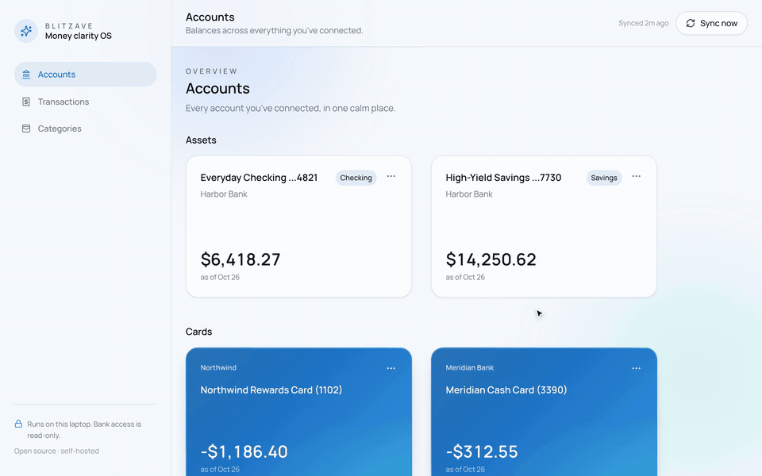
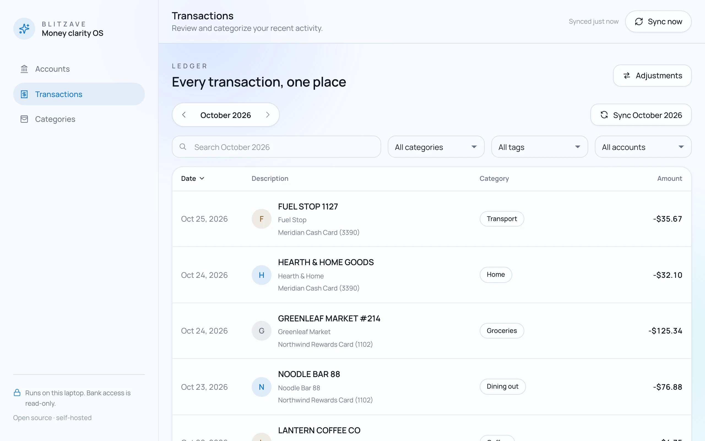
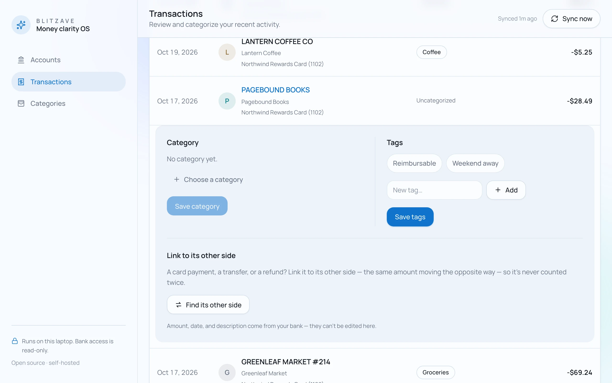
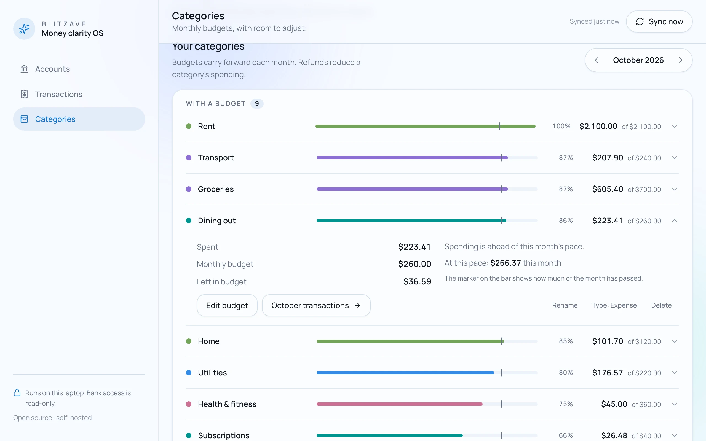
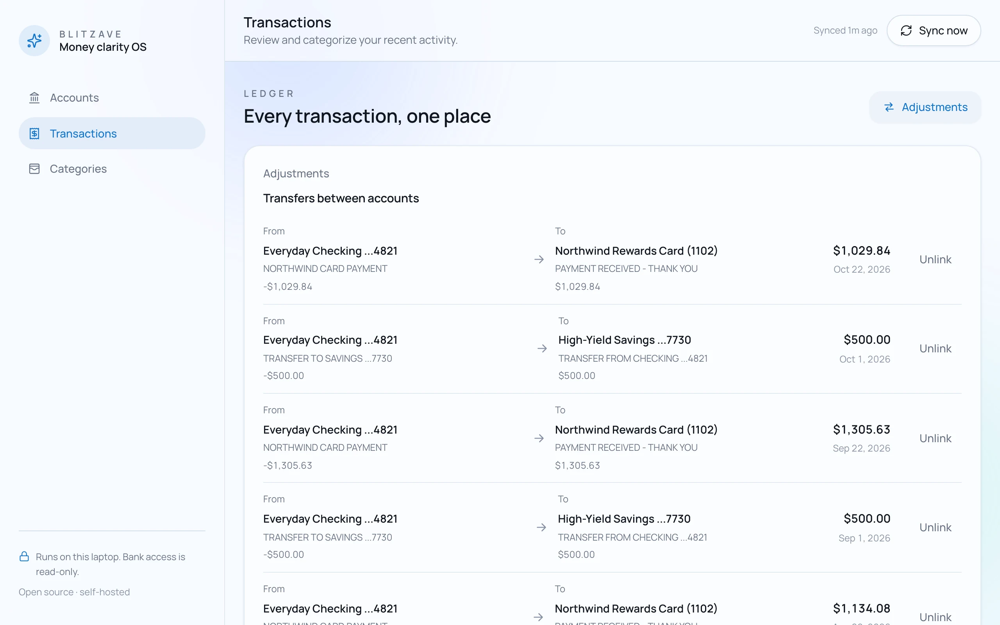
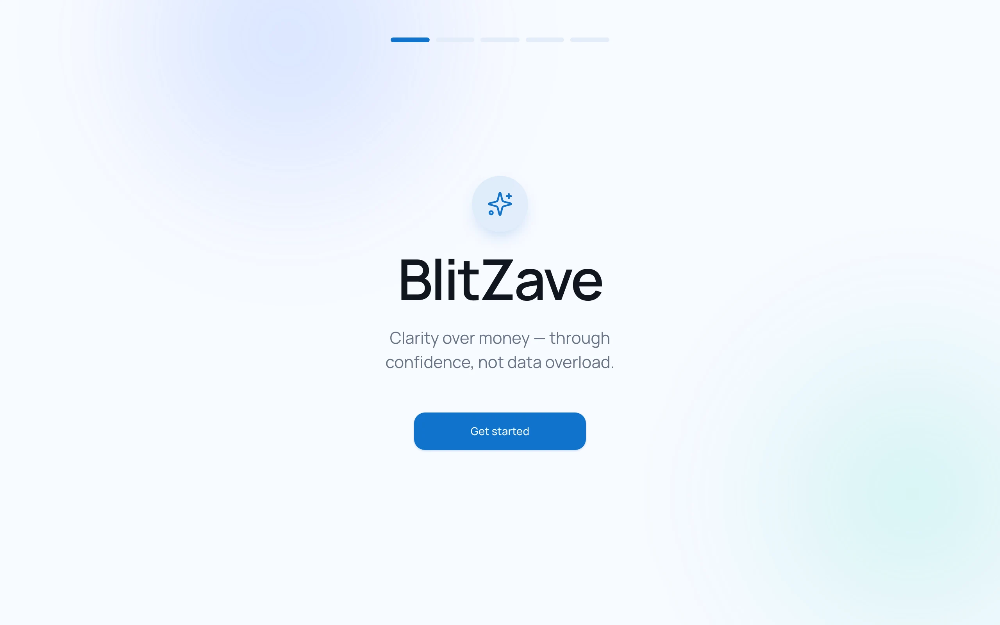
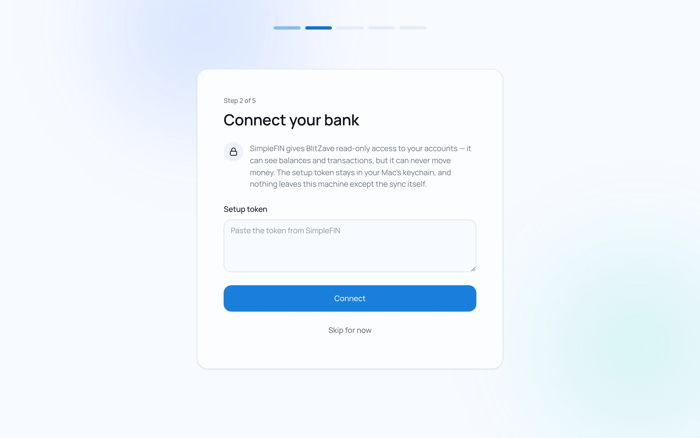
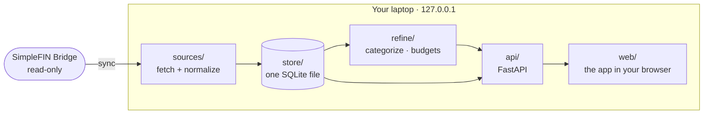

<div align="center">


# BlitZave

**Clarity over money.**<br>
A calm, open-source personal finance app that runs on your own laptop.

[](LICENSE)
[](https://www.python.org/)
[](https://github.com/blitzave/blitzave/actions/workflows/ci.yml)
[](#privacy-by-design)
[](#roadmap)
[](https://discord.com/invite/VerUYP67)

[Website](https://blitzave.github.io/blitzave/) · [Quick start](#quick-start) · [Setup guide](#setup-guide) · [Roadmap](#roadmap) · [Contributing](CONTRIBUTING.md) · [Discord](https://discord.com/invite/VerUYP67)

<br>



<sub>Every screenshot uses made-up data from fictional banks.</sub>

</div>

---

## Why BlitZave

Most money apps are a **noun**: they answer *"what is my money?"* with a balance,
a pie chart, a wall of numbers. BlitZave is a **verb**: it answers *"what am I
doing with money, and is it working?"*

It's built around one rule: **an ally, never a scorekeeper.** BlitZave reports
what happened and leaves the judgment out. No red numbers for spending, no
streaks to break, no guilt. The surface stays calm, and the detail is always
one tap down.

And it's yours. BlitZave runs on your laptop, keeps everything in one SQLite
file you own, and reads your bank through **read-only** access you control.
No account to create, no company server holding your data, no subscription.

| | **BlitZave** | **Typical hosted budgeting app** |
|---|---|---|
| Price | Free and open source (Apache-2.0) | Monthly or yearly subscription |
| Where your data lives | One file on your laptop | The company's servers |
| Account required | No | Yes |
| Bank access | Read-only, through your own SimpleFIN connection | Through the company's aggregator |
| Telemetry | None | Usually |
| Tone | Reports behavior, never scolds | Often streaks, alerts, and red numbers |

## Features

<table>
<tr>
<td width="50%" valign="top">

**A calm month, one page at a time**<br>
Every transaction across checking, savings and cards, one month per page.
Search, filter by category, tag or account, and re-sync any single month from
your bank with one click.

</td>
<td width="50%"></td>
</tr>
<tr>
<td width="50%" valign="top">

**Teach it once**<br>
Categorize a purchase and choose "all transactions like this." Matching ignores
store numbers, reference codes, wallet prefixes like Apple Pay, and small
typos, and every future sync follows. Your own corrections always win.

</td>
<td width="50%"></td>
</tr>
<tr>
<td width="50%" valign="top">

**Budgets with context, not alarms**<br>
Monthly budgets carry forward. A marker shows how much of the month has passed,
and the pace is described in plain words. Going over is information, never a
red failure state.

</td>
<td width="50%"></td>
</tr>
<tr>
<td width="50%" valign="top">

**Every dollar counted once**<br>
Link a card payment or a transfer between your accounts so it never counts as
spending, and link a refund to the charge it reverses. Both sides stay in each
account's ledger, so balances still reconcile.

</td>
<td width="50%"></td>
</tr>
</table>

Also included: split a transaction across categories, tags, an accounts overview
with balances, account-type corrections that survive every sync, and a full
local API with interactive docs at `/docs`.

## Quick start

You need **[uv](https://docs.astral.sh/uv/)** (it installs Python 3.12 for you)
and a **[SimpleFIN Bridge](https://bridge.simplefin.org/)** account.

```bash
uv tool install git+https://github.com/blitzave/blitzave
blitzave
```

BlitZave opens in your browser at **http://127.0.0.1:8742**. Paste your SimpleFIN
setup token, and you're done. Run `blitzave` from any terminal whenever you want
to open it.

> BlitZave is built and tested on macOS. Linux should work with a running
> Secret Service keychain; Windows is untested. Reports are welcome either way.

## Setup guide

A complete walkthrough, from nothing to your first calm month. It takes about
ten minutes, most of it in SimpleFIN.

### 1. Install uv

uv manages Python and BlitZave's dependencies in one tool.

```bash
# macOS and Linux
curl -LsSf https://astral.sh/uv/install.sh | sh
```

On macOS you can also use `brew install uv`. For Windows and other options, see
the [uv installation guide](https://docs.astral.sh/uv/getting-started/installation/).

### 2. Install BlitZave

```bash
uv tool install git+https://github.com/blitzave/blitzave
```

This installs the `blitzave` command, with its own Python and dependencies,
so it runs from any folder. There's nothing to clone.

### 3. Connect your bank in SimpleFIN

BlitZave reads your accounts through [SimpleFIN Bridge](https://bridge.simplefin.org/),
a small independent service that gives apps **read-only** access to your bank
data. You bring your own SimpleFIN account, so your bank connection belongs to
you, not to us. SimpleFIN charges a small subscription, paid directly to them.

1. Create an account at [bridge.simplefin.org](https://bridge.simplefin.org/).
2. Connect your banks and cards there.
3. Create a new app connection and copy the **setup token** it gives you.

The setup token is one-time: BlitZave exchanges it for an access credential and
stores that credential only in your operating system's keychain.

### 4. Start BlitZave

```bash
blitzave
```

The first run creates your data folder at `~/BlitZave/`, syncs, and opens the
app in your browser at **http://127.0.0.1:8742**. Keep the terminal open while
you use it; press `Ctrl+C` to stop.

### 5. Onboard

If you close the tab, open http://127.0.0.1:8742 again while BlitZave is running.

<table>
<tr>
<td width="50%"></td>
<td width="50%"></td>
</tr>
</table>

1. Choose **Get started**.
2. Paste your setup token and choose **Connect**. BlitZave runs its first sync,
   pulling the last 90 days. Checking, savings and credit card accounts are
   supported today; investment and loan accounts are skipped for now.
3. Check your accounts. BlitZave guesses each account's type (checking, savings
   or credit card) from its name.
   Your correction survives every future sync. (It's on the **Accounts** page,
   under each account's `⋯` menu, any time later too.)

### 6. Make it yours

- **Categories.** Create the categories you care about on the **Categories**
  page and give expense categories an optional monthly budget.
- **Categorize.** On **Transactions**, open any row and pick a category. Choose
  *All transactions like this* to teach BlitZave the merchant; matching
  transactions are updated now and in every future sync.
- **Link adjustments.** For a credit card payment or a transfer between your
  own accounts, open the row, choose **Find its other side**, and pick the
  matching transaction. It stops counting as spending. Refunds link the same
  way. Review everything linked under **Adjustments**.
- **Look back.** Use the month arrows to move through history. To pull a month
  older than your first sync, open it and choose **Sync *Month Year***.

### Day to day

BlitZave syncs every time it starts, so the latest is waiting when you open it.
Use **Sync now** in the top bar any time, or the per-month sync for history.

### Where your data lives

| What | Where |
|---|---|
| Your database | `~/BlitZave/blitzave.db` (one SQLite file) |
| Your SimpleFIN credential | Your OS keychain, under the service name `blitzave` |
| Everything else | Nowhere. There's no server. |

Set `BLITZAVE_HOME` to keep the data folder somewhere else:

```bash
BLITZAVE_HOME=~/Documents/BlitZave blitzave
```

**Back up** by copying the database while BlitZave is stopped, or at any time
with SQLite's online backup:

```bash
sqlite3 ~/BlitZave/blitzave.db ".backup ~/blitzave-backup.db"
```

### Update

Stop BlitZave, then:

```bash
uv tool upgrade blitzave
blitzave
```

Database migrations run automatically on startup and never touch your existing
transactions.

**Hearing about new versions.** Update checks are off until you turn them on,
either at the end of setup or with **Check for updates** at the bottom of the
sidebar. Once they're on, BlitZave asks GitHub for the latest release at most
once a day, when it starts. It sends nothing about you or your money, not even
which version you run; the comparison happens on your laptop. When a newer
release exists, one line at the top of the app says so. Turn checks off the same
way. Or skip all that and choose **Watch → Custom → Releases** on the
[repository](https://github.com/blitzave/blitzave) to hear by email.

### Uninstall

Stop BlitZave, uninstall it, delete `~/BlitZave/`, then remove the keychain
entry. On macOS you can also delete the item named `blitzave` in
**Keychain Access**.

```bash
uv tool uninstall blitzave
uvx keyring del blitzave simplefin_access_url
```

### Troubleshooting

| Symptom | What to do |
|---|---|
| `command not found: blitzave` | Run `uv tool update-shell`, then open a new terminal. |
| `Git operation failed` during install | uv needs Git. On macOS, run `xcode-select --install`, then install again. |
| `address already in use` on start | BlitZave is already running in another terminal. Use that one, or stop it first. |
| "SimpleFIN access was revoked" | Create a new setup token in SimpleFIN. Then open http://127.0.0.1:8742/docs, expand `POST /api/connect`, choose *Try it out*, and send `{"setup_token": "<your new token>"}`. It replaces the old credential. |
| "Your SimpleFIN subscription needs payment" | Renew your SimpleFIN Bridge subscription, then sync again. |
| An account shows the wrong type | Open the account's `⋯` menu and correct it. |
| Keychain errors on Linux | Make sure a Secret Service provider (GNOME Keyring or KWallet) is running. |

Still stuck? Ask on [Discord](https://discord.com/invite/VerUYP67).

## Privacy by design

- **Local-only server.** BlitZave listens on `127.0.0.1` only, never on your network.
- **Read-only bank access.** SimpleFIN can see balances and transactions; it can never move money.
- **One network call by default.** Syncing with your own SimpleFIN account is the only thing that touches the internet. The one other call, a daily update check against GitHub, stays off until you turn it on and sends nothing about you. No telemetry, no analytics, no remote fonts.
- **Your keychain, not our database.** The SimpleFIN credential lives in the OS keychain, never in the database, logs or exports.
- **No account, no server.** We don't hold your data. We can't sell what we never have.

## How it works



One Python process, one data file, one command to start. The engine (ingestion,
storage, analysis, the API) is built in small, tested steps. The UI is plain
HTML, CSS and JavaScript modules served by the engine itself, and it can only
show what the API has already decided:

- **Money is integer cents**, parsed with exact integer arithmetic, never floats.
- **Every dollar is counted once.** Linked transfers never count as spending.
- **The bank's record is never rewritten.** A sync never changes an existing amount.
- **Your corrections always win** over rules.

Explore the full API at **http://127.0.0.1:8742/docs** while BlitZave is running.

| Stack | |
|---|---|
| Engine | Python 3.12, FastAPI, Pydantic v2, uvicorn |
| Storage | SQLite (WAL, `STRICT` tables), numbered migrations |
| Bank data | SimpleFIN via httpx |
| Secrets | OS keychain via keyring |
| UI | HTML, CSS and ES modules, no build step |
| Tooling | uv, pytest, ruff |

## Roadmap

BlitZave is in **alpha**: ready for daily use by curious people, with rough
edges.

**Shipped**
- [x] SimpleFIN connection, sync on startup, per-month sync
- [x] Accounts with type corrections that survive syncs
- [x] Month-by-month ledger with search and filters
- [x] Categories, splits, tags, and "apply to all" rules
- [x] Monthly budgets with pace, never alarms
- [x] Manual transfer and refund linking

**Next: the BlitZave MVP, the Savings arc**
- [ ] Local snapshots and one-click export and import
- [ ] Automatic matching for card payments and transfers
- [ ] Savings goals, set right alongside your categories
- [ ] Pay yourself first: how much moved to savings, and did it move before spending?
- [ ] Goal trajectory: at your usual pace, when is the goal reached? (a range, so one
  light month barely moves it)
- [ ] A home screen with the one thing that matters right now. Wins get celebrated in
  plain words; a light month is absorbed, never a broken streak.

**After that**
- [ ] Ask BlitZave: questions about your own money, answered from your own data. First
  as a read-only MCP server for the AI app you already use, then in the app itself.
  Every number comes from BlitZave's own calculations, never from the model.
- [ ] Recurring charges on their own page, including price changes
  ("went from $15.49 to $17.99")
- [ ] More of **the Vital Five** behavior cards:
  - Consistency: are expenses steady, not spiky?
  - Lifestyle creep: is spending rising as income rises?
  - Mindful vs. impulse: planned versus reactive spending
- [ ] Spending by tag, for trips and projects

**Open source, for good.** The core of BlitZave stays free and open source
under Apache-2.0. A managed version for people who'd rather not self-host may
come later; self-hosting will always be first-class.

## Community

- **[Discord](https://discord.com/invite/VerUYP67)**: questions, ideas, and the people building BlitZave
- **[Issues](https://github.com/blitzave/blitzave/issues)**: bugs and feature ideas
- **[Contributing](CONTRIBUTING.md)**: how we build, and the rules that never bend
- **[Security](SECURITY.md)**: report vulnerabilities privately

## License

BlitZave is licensed under the [Apache License 2.0](LICENSE). Contributions are
accepted under the [Contributor License Agreement](CLA.md). The Manrope typeface
is licensed under the [SIL Open Font License 1.1](src/blitzave/web/fonts/OFL.txt).
