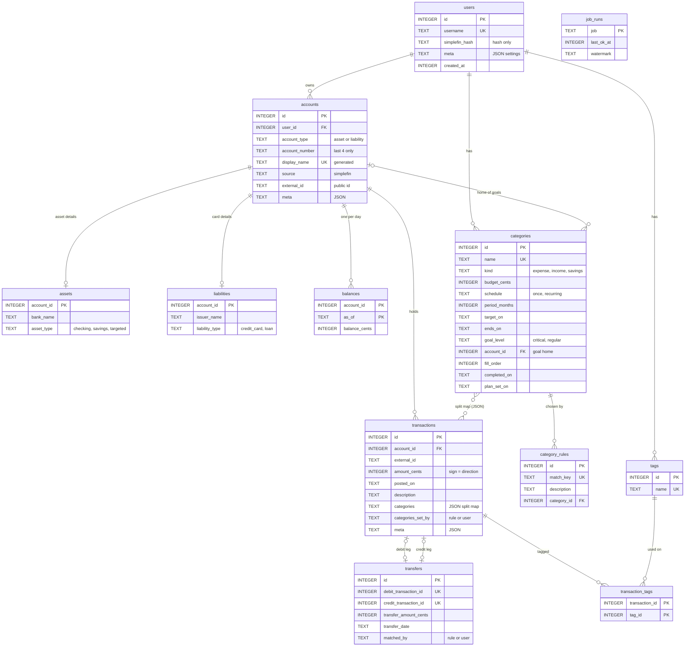

# BlitZave's database

Everything BlitZave knows lives in one SQLite file, `~/BlitZave/blitzave.db`. This
document is the current state of its schema: every table and column, and the rules the
database enforces on its own. How the code around it fits together is in
[ARCHITECTURE.md](ARCHITECTURE.md).

## Status

| | |
|---|---|
| Schema version | **10** (`PRAGMA user_version`) |
| Tables | 12: `users`, `accounts`, `assets`, `liabilities`, `balances`, `transactions`, `transaction_tags`, `tags`, `categories`, `category_rules`, `transfers`, `job_runs` |
| Views | 1: `activity` |
| Indexes | 1 of its own (`tx_posted`), plus the ones SQLite makes for primary keys and `UNIQUE` |
| Triggers | 10 |
| On `main` | Migrations 001–007 |
| On branch `goal-schedules` | 008 (schedules), 009 (goal homes) and 010 (when a plan was set): built, tested and committed, but not merged yet. They can still change until they reach `main`. After that they're frozen, and CI blocks edits. |
| Last checked | 2026-11-08, on a fresh database built from the migrations |

Every table is `STRICT`, so a column only ever holds its declared type. Foreign keys are
on for every connection.

## How the tables relate

The dotted line is a soft link. `transactions.categories` is a JSON map of category ids,
not a foreign key, so a category in use is found with `json_each()` (and deleting one
in use is refused in code).

## Rules that hold everywhere

- **Money is integer cents.** `amount_cents`, `balance_cents`, `budget_cents`,
  `transfer_amount_cents`. Text conversion happens only in `api/money.py`.
- **Dates are ISO text** (`YYYY-MM-DD`). New date columns are checked with
  `col IS date(col)`. Timestamps (`created_at`, `last_ok_at`) are unix seconds.
- **Accounts have two ids.**
  - `accounts.id` is internal and never leaves `store/`.
  - Everything outside `store/` uses `external_id`, SimpleFIN's own account id. That
    includes goals' `account_id` in API responses.
- **No full account numbers.** `account_number` is the last four digits.
- **No credentials.** The SimpleFIN access URL is in the OS keychain;
  `users.simplefin_hash` is only a hash of it.
- **One local user.** `user_id` columns exist so the shape is honest, but there's one row
  in `users`.

## Tables

### `users`
The one local user, and settings that don't deserve a table.

| Column | Type | Notes |
|---|---|---|
| `id` | INTEGER PK | |
| `username` | TEXT, UNIQUE | |
| `simplefin_hash` | TEXT | Hash of the SimpleFIN access URL. Never the URL. |
| `meta` | TEXT JSON | `update_check` (true, false, or absent until asked), `update_checked_on`, `latest_version` |
| `created_at` | INTEGER | unix seconds |

### `accounts`
One row per bank account or card SimpleFIN returns that BlitZave supports.

| Column | Type | Notes |
|---|---|---|
| `id` | INTEGER PK | Internal only. |
| `user_id` | INTEGER FK → users | |
| `account_type` | TEXT | `asset` or `liability`. Picks which extension table the account has a row in. |
| `account_number` | TEXT | Last 4 digits. `meta.account_number_source` says where they came from. |
| `display_name` | TEXT, generated, UNIQUE | `account_type || '-' || account_number`, e.g. `liability-1002`. A uniqueness key. The UI shows `meta.name`. |
| `source` | TEXT | `simplefin` |
| `external_id` | TEXT | SimpleFIN's account id: the public id. `UNIQUE (source, external_id)` |
| `meta` | TEXT JSON | `name` (the bank's name for the account), `account_number_source` |

### `assets`
The asset side of an account. A trigger allows a row only for an `asset` account.

| Column | Type | Notes |
|---|---|---|
| `account_id` | INTEGER PK, FK → accounts | |
| `bank_name` | TEXT | |
| `asset_type` | TEXT | The account's **job**: `checking` (pay in, spending out), `savings` (a short buffer for this month's bills) or `targeted` (holds goals; **Goal account** in the UI). A sync guesses `checking` or `savings` from the name and never guesses `targeted`. A user correction survives every sync. |

Rebuilt in migration 009 to allow `targeted`; the rows were copied across unchanged.

### `liabilities`
The card side of an account. A trigger allows a row only for a `liability` account.

| Column | Type | Notes |
|---|---|---|
| `account_id` | INTEGER PK, FK → accounts | |
| `issuer_name` | TEXT | |
| `liability_type` | TEXT | `credit_card` or `loan`. Loans are modeled but not ingested yet. |

### `balances`
SimpleFIN only reports today's balance, so history that isn't recorded at sync time is
gone. One row per account per day; a second sync on the same day overwrites it.

| Column | Type | Notes |
|---|---|---|
| `account_id` | INTEGER FK → accounts | PK with `as_of` |
| `as_of` | TEXT | ISO date |
| `balance_cents` | INTEGER | Signed. A card's balance is negative when you owe. |

The latest row per account is each goal account's money on the Savings page.

### `transactions`
Every transaction the bank reported. The bank's record is never edited: amount, date,
description and account are fixed. Only metadata changes.

| Column | Type | Notes |
|---|---|---|
| `id` | INTEGER PK | |
| `user_id` | INTEGER FK → users | |
| `account_id` | INTEGER FK → accounts | |
| `external_id` | TEXT | SimpleFIN's transaction id. `UNIQUE (account_id, external_id)`, so a re-fetch never duplicates. |
| `amount_cents` | INTEGER | Negative: money left the account. Positive: it arrived. |
| `currency` | TEXT | 3 letters, default `USD` |
| `transaction_type` | TEXT | `debit` or `credit`. A CHECK keeps it agreeing with the sign of `amount_cents`. |
| `posted_on` | TEXT | ISO date. Indexed (`tx_posted`). |
| `description`, `merchant_name` | TEXT | As the bank sent them. |
| `categories` | TEXT JSON | `{category_id: fraction}`, so one purchase can be split across categories. `{}` means uncategorized. |
| `categories_set_by` | TEXT | `rule` or `user`. A sync never overwrites a row that's already set. |
| `meta` | TEXT JSON | `no_auto_transfer: true` after you unlink a pair, so the matcher leaves it alone. `goal_question: {goal_id, answer}` once "was that the goal?" is answered (`bought` or `other`), so it's never asked again. |
| `created_at` | INTEGER | unix seconds |

### `transfers`
Every matched pair: an exactly opposite debit and credit. What a pair is called is
decided when it's shown, never stored:

| Legs | Shown as |
|---|---|
| in two accounts | transfer |
| one account, same merchant | refund |
| one account, different merchant | credit |

| Column | Type | Notes |
|---|---|---|
| `id` | INTEGER PK | |
| `user_id` | INTEGER FK → users | |
| `debit_transaction_id` | INTEGER, UNIQUE, FK → transactions | A transaction is a leg of at most one pair. |
| `credit_transaction_id` | INTEGER, UNIQUE, FK → transactions | |
| `transfer_amount_cents` | INTEGER | Equals both legs' unsigned amount (trigger). |
| `transfer_date` | TEXT | |
| `description` | TEXT | |
| `matched_by` | TEXT | `rule` (the sync's matcher) or `user` |
| `meta` | TEXT JSON | |
| `created_at` | INTEGER | |

Pairs are never edited: unlink (delete the row) and link again. Transfer legs never get a
category.

### `categories`
Spending, income and savings categories. A **goal** is a `savings` category with an
amount, a level and a home account. There's no separate goals table.

| Column | Type | Added | Notes |
|---|---|---|---|
| `id` | INTEGER PK | 001 | |
| `user_id` | INTEGER FK → users | 001 | |
| `name` | TEXT | 001 | `UNIQUE (user_id, name)` |
| `kind` | TEXT | 001 | `expense`, `income` or `savings` |
| `budget_cents` | INTEGER | 005 | The amount, > 0, or NULL for none. For a goal, its target. |
| `schedule` | TEXT | 008 | `once` (the amount by `target_on`) or `recurring` (the amount every `period_months`) |
| `period_months` | INTEGER | 008 | 1, 2, 3, 4, 6 or 12. Rounds follow the calendar (a 3-month period is Jan–Mar, Apr–Jun, …), so the period divides the year. |
| `target_on` | TEXT | 008 | ISO date. Required for `once`; NULL for `recurring`. |
| `ends_on` | TEXT | 008 | ISO date. Optional end of a recurring amount. |
| `goal_level` | TEXT | 009 | `critical` or `regular`. NULL: not a goal. |
| `account_id` | INTEGER FK → accounts | 009 | The goal's home, a `targeted` asset account. |
| `fill_order` | INTEGER | 009 | Place in the account's line, ≥ 1. Gaps are fine; order is what counts. |
| `completed_on` | TEXT | 009 | ISO date the goal was bought. A completed goal keeps its home for history but no longer holds the account or shares its money. |
| `plan_set_on` | TEXT | 010 | ISO date the plan (amount and schedule) was last set. A round closes with a result, and only rounds since this date count, so a budget set today never reports rounds from before it existed. Any plan change resets it; a rename doesn't. Plans that existed before 010 count from the day it ran. |

Every budget set before 008 became `recurring`, monthly.

**Plan shapes** (trigger `categories_schedule_*`):

| Shape | `budget_cents` | `schedule` | `period_months` | `target_on` | `ends_on` |
|---|---|---|---|---|---|
| No amount | NULL | NULL | NULL | NULL | NULL |
| One time | set | `once` | NULL | set | NULL |
| Recurring | set | `recurring` | set | NULL | optional |

**Goal shapes** (trigger `categories_goal_rules_*`):

| Shape | `goal_level` | `account_id` | `fill_order` | `completed_on` | Also needs |
|---|---|---|---|---|---|
| Not a goal | NULL | NULL | NULL | NULL | — |
| Active goal | set | set | set | NULL | `kind = 'savings'`, an amount, a `targeted` home, and the critical rule |
| Completed goal | set | set | set | set | `kind = 'savings'`, an amount |

The **critical rule**: a critical goal has its account to itself. While it's active,
nothing else active lives there, and it can't move into an account that holds
anything. Regular goals share an account and fill in `fill_order`.

### `category_rules`
"Apply to all": when you categorize one transaction and say "all like this", the choice
is kept here and every later sync applies it.

| Column | Type | Notes |
|---|---|---|
| `id` | INTEGER PK | |
| `user_id` | INTEGER FK → users | |
| `match_key` | TEXT, not empty | `refine/categorize.match_key(description)`: the merchant's words, lowercased, with wallet prefixes and any word containing a digit (store numbers, reference codes) dropped. `UNIQUE (user_id, match_key)` |
| `description` | TEXT | The example the rule was made from. |
| `category_id` | INTEGER FK → categories | `ON DELETE CASCADE`: a rule goes with its category. |
| `created_at` | INTEGER | Oldest rule wins a tie. |

### `tags` and `transaction_tags`
Free-form labels, any number per transaction. `tags` has `UNIQUE (user_id, name)`;
`transaction_tags` is the `(transaction_id, tag_id)` link table.

### `job_runs`
Bookkeeping for the pipeline.

| Column | Type | Notes |
|---|---|---|
| `job` | TEXT PK | `ingest` (the sync), `match_transfers` (records that the one full matching pass ran) |
| `last_ok_at` | INTEGER | unix seconds |
| `watermark` | TEXT | Last date done. The next sync starts 7 days before it, because banks post late. |

## The view

**`activity`**: every transaction that isn't a leg of a pair. Spending, budgets and
analysis read this, so a card payment or a transfer between your own accounts never
counts as spending.

## Triggers

SQLite can't put a CHECK across tables, or across columns added later, so these do it.
Each one refuses with a plain message, which the API turns into a 409.

| Trigger | Table, when | Refuses |
|---|---|---|
| `assets_require_asset_type` | assets, insert | an asset row for an account that isn't `asset` |
| `liabilities_require_liability_type` | liabilities, insert | a card row for an account that isn't `liability` |
| `transfers_must_balance` | transfers, insert | legs that aren't an equal debit and credit, in one currency, for the same user, matching the amount |
| `transfers_cannot_be_updated` | transfers, update | any edit (unlink and link again) |
| `categories_schedule_on_insert` / `_on_update` | categories | a plan that doesn't match a shape above |
| `categories_goal_rules_on_insert` / `_on_update` | categories | a half goal, a goal outside a `targeted` account, or a broken critical rule |
| `assets_goal_home_keeps_its_job` | assets, update of `asset_type` | changing the job of an account that holds active goals |
| `assets_goal_home_stays_an_asset` | assets, delete | turning an account that holds active goals into a card |

## Migration history

| # | File | Date | What it did |
|---|---|---|---|
| 001 | `001_init.sql` | 2026-10-24 | Users, accounts (with `assets`/`liabilities`), categories, tags, transactions, transfers, the `activity` view, the type triggers. |
| 002 | `002_ingestion.sql` | 2026-10-25 | `balances` and `job_runs`, for syncing. |
| 003 | `003_category_rules.sql` | 2026-10-26 | `category_rules`, matching the exact description. |
| 004 | `004_category_rules_match_key.sql` | 2026-10-26 | Rebuilt `category_rules` to match a normalized `match_key`. |
| 005 | `005_category_budgets.sql` | 2026-10-26 | `categories.budget_cents`, a monthly budget. |
| 006 | `006_refunds.sql` | 2026-10-26 | A separate `refunds` table (replaced by 007). |
| 007 | `007_one_pairs_table.sql` | 2026-11-02 | Every pair in `transfers`; moved refunds across and dropped `refunds`; pairs can't be edited. |
| 008 | `008_category_schedules.sql` | 2026-11-06 | One-time or recurring amounts; old budgets became monthly. |
| 009 | `009_goal_homes.sql` | 2026-11-06 | The `targeted` account job; goals' level, home, place in line and completion, with their rules. |
| 010 | `010_plan_set_on.sql` | 2026-11-08 | `categories.plan_set_on`, so rounds count only from when a plan was set. |

## Export and import

`GET /api/export` writes every table above, in the order foreign keys need, as
`{format, schema_version, tables: {name: {columns, rows}}}`. It leaves out
`users.simplefin_hash` and the generated `accounts.display_name`.
`POST /api/import` loads that document into an install with no data, in one
transaction. Every row goes through the same CHECKs and triggers, so an export
that was edited into something the schema forbids is refused whole. A new
generated column must be added to `LEFT_OUT` in `store/export.py`; the
round-trip test fails until it is.

## Changing the schema

1. **Add a numbered file** to `store/migrations/` (`010_…sql`). Never edit one that has
   reached `main`; CI blocks it.
2. **Write it to run once, as a script.** `db.migrate` runs each pending file and bumps
   `user_version`.
3. **Rebuild a table to change a CHECK.** SQLite can't alter one: create the new table,
   copy, drop, rename, and recreate the old table's triggers (009 does this to
   `assets`).
4. **Expect a copy first.** Before the first pending migration on a database that holds
   data, the file is copied to `~/BlitZave/backups/`. If the copy fails, nothing
   changes.
5. **Don't try schema changes elsewhere.** After migrating, the connection refuses
   them.
6. **Test the upgrade.** Build the previous version, add rows, migrate, and check
   nothing moved. See `tests/test_goal_homes.py` and `tests/test_category_schedules.py`.

## Not in the schema yet

These wait until they're needed:

| Planned | Why it isn't here yet |
|---|---|
| Behavior cards (`insights`) | Arrive with the detectors. |
