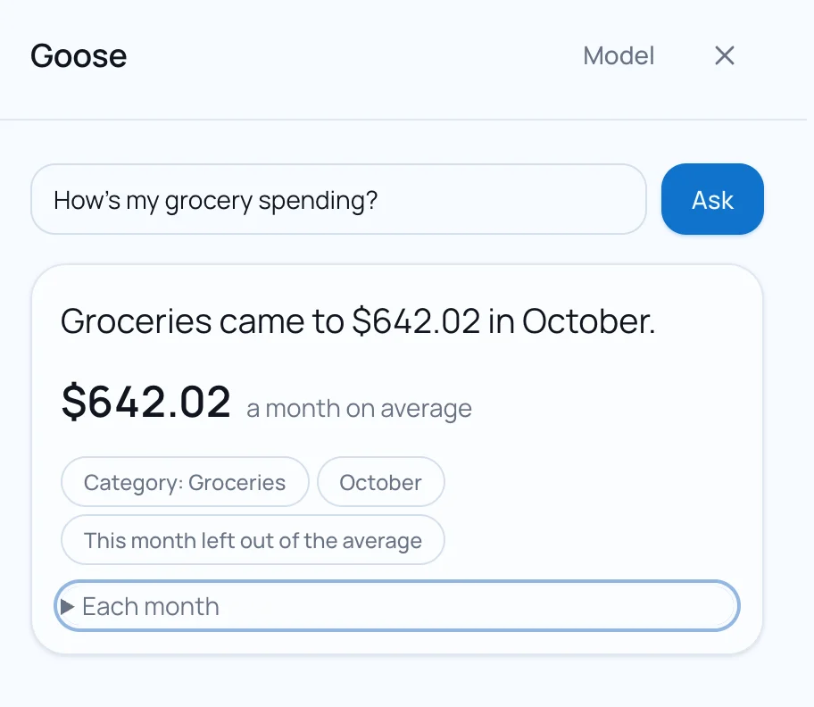
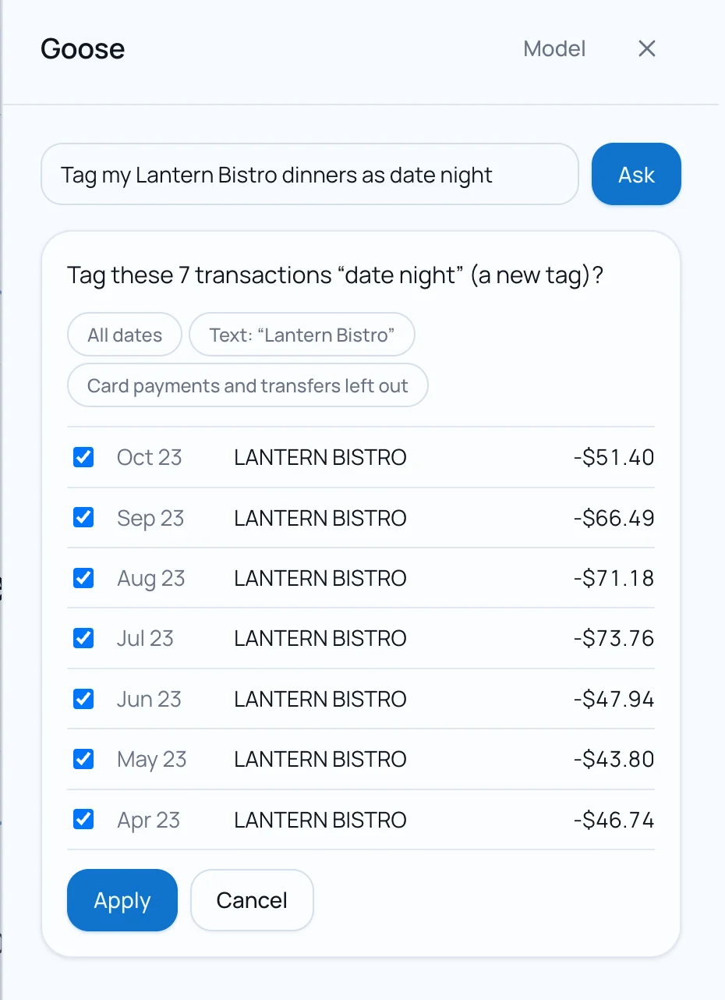
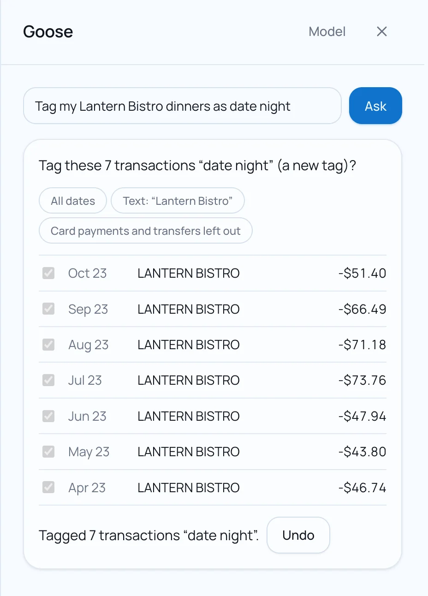
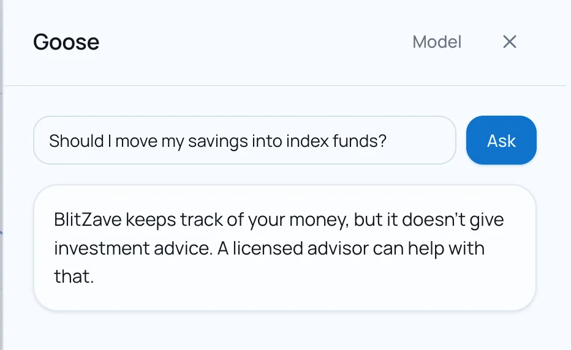
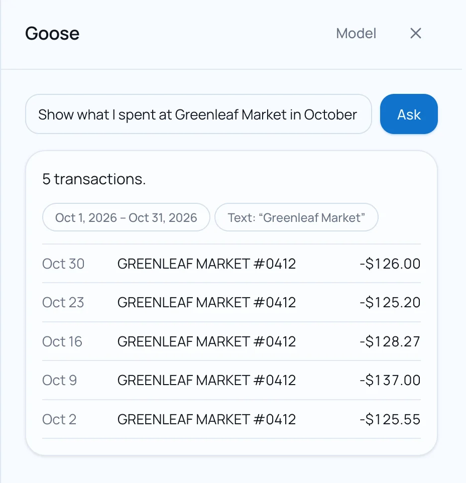
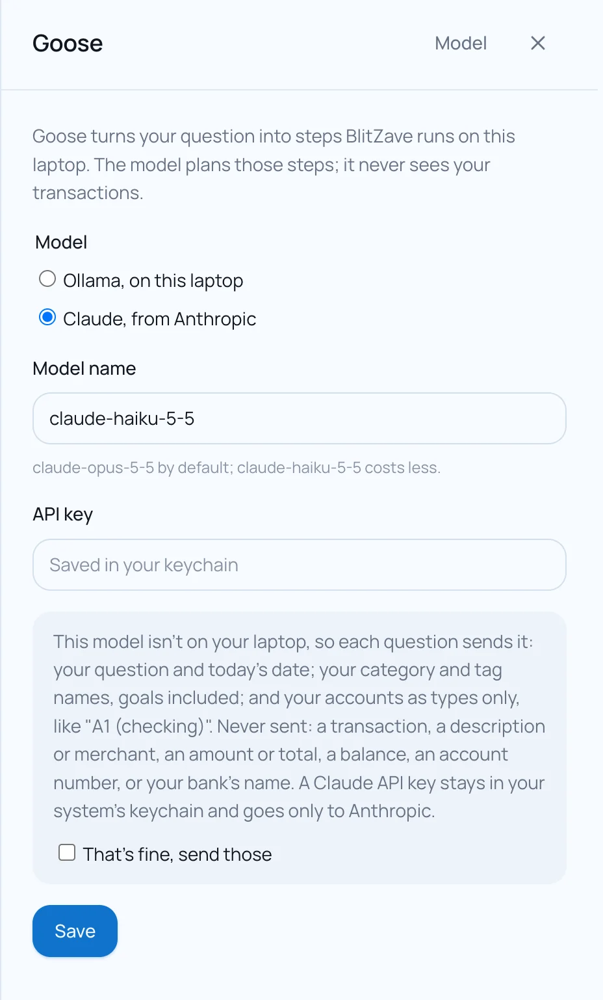

BlitZave has a new member of the family. Its name is Goose.

Goose is the part of BlitZave you can talk to: a partner for keeping track of your spending and your savings. Open Home, press **Ask Goose about your money**, and ask in your own words. No menus, no filters to set up, no report builder. You don't need a minor in accounting to use it.

And here's the part I'm proudest of: **the AI behind Goose never sees your money.** Not a transaction, not a balance, not an answer. Plenty of money apps have a chatbot now, and they work by reading your data. As far as I know, Goose is the first assistant in a money app that can actually do things for you, like tagging a trip or filing a purchase, without its AI ever seeing your data.

## What you can ask

Goose does four things today: it finds transactions, adds up your spending, tags things, and files them under a category. Here it is on BlitZave's demo household, where the banks and every dollar are made up.

<figure class="shot">

<figcaption>A question in plain words, and an answer in BlitZave's own numbers. The chips show how Goose read it.</figcaption>
</figure>

Tagging works the same way, with one extra step: you see exactly what will change first.

<figure class="shot">

<figcaption>First a preview, a box on every row.</figcaption>
</figure>
<figure class="shot">

<figcaption>Then your Apply, and an Undo.</figcaption>
</figure>

And when a question isn't about tracking your money, Goose says so.

<figure class="shot">

</figure>

That last one matters as much as the first two. BlitZave tracks your money. It doesn't manage it, and Goose won't pretend otherwise.

## Why it's different

Most AI assistants work by reading your data. You ask a question, the AI pulls your transactions into its head, does some math, and writes an answer. That's what makes them clever. It's also what makes them a risk with money: your bank history goes to whoever runs the AI, and the numbers you read are the AI's arithmetic.

Goose splits that job in two:

1. **The AI reads your question and makes a plan.** "Show the grocery spending, month by month." It knows your category names and today's date. That's all.
2. **BlitZave carries the plan out, on your laptop.** It finds the rows, does the math and shows you the answer. The AI never finds out what was there.

So a few things are always true, whatever the AI does:

- **Every number comes from BlitZave**, never from the AI. If the AI tries to type a figure, it doesn't get shown.
- **Nothing changes until you press Apply.** And Undo takes it back.
- **You see how it read you.** Every list, summary and preview shows what Goose thought you asked, so a misunderstanding is obvious.
- **It's an ally, not a scorekeeper.** Goose reports what happened. It never tells you that you overspent.

<figure class="shot">

<figcaption>The dates and the merchant Goose understood, right above the rows.</figcaption>
</figure>

## Your laptop, your choice of AI

Goose works with an AI that runs on your own laptop, through Ollama, so nothing leaves your machine at all. If you'd rather use Claude, you can opt in. Before the first question, BlitZave shows you exactly what Claude would get, and what it never will:

<figure class="shot">

<figcaption>Nothing goes to Claude until you tick that box.</figcaption>
</figure>

One honest note: a small AI on a laptop will misread you more often than a big one. That's why every list and summary shows how it read your question, and why nothing changes without your click.

## What it can't do

Goose can't explain *why* July ran high, because explaining means reading your transactions, and nothing that thinks ever reads them. It doesn't remember your last question. And it can only do the four things above. Those limits are on purpose: they're what let an AI anywhere near your money.

If you want the full story of how it's built, from the diagrams to the tests to a leak I caught in my own design, it's all in [Goose plans. BlitZave does.](../goose-plans-blitzave-does/)

**Try it.** Install BlitZave from the [guide](../../guide/), open Home, and press **Ask Goose about your money**. Then tell me what it got wrong on [Discord](https://discord.gg/akSZ794XxG).
{: .note}
